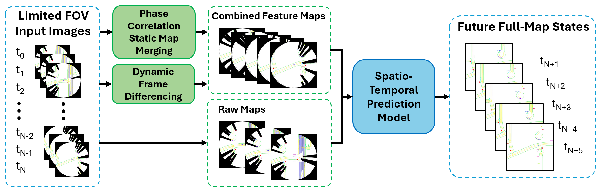

# Knowing Your Blind Spots: Dynamic Map Prediction for Partially Observable Environments

<p align="center" width="100%">
  
</p>

This repository contains the code implementation of our 2026 paper, "Knowing Your Blind Spots: Dynamic Map Prediction for Partially Observable Environments". Our work focuses on the problem of predicting dynamic future map states using inputs subject to limited field-of-view and occlusions. We approach the problem through the following contributions:

* We present a novel approach for map feature extraction through static map merging and dynamic difference frame features, which boosts map prediction model performance while simultaneously reducing the number of required model input images, thereby increasing inference speed.
* We create and share a benchmark for dynamic occupancy map prediction in partially observable environments.
* We demonstrate the effectiveness of existing spatio-temporal prediction models as future map state estimators in combination with our map feature extraction method through multiple experiments.

For more information, please check out our paper: (coming soon)
<!-- <p align="left">
<a href="TBD" alt="arXiv">
    </a>
</p> -->

## Dataset

The partially-observable map prediction dataset created and used in this work is available here: [https://research.coe.drexel.edu/shared/ece/imaple/BlindSpotData](https://research.coe.drexel.edu/shared/ece/imaple/BlindSpotData)

## Installation

This project uses the TAU model through the OpenSTL framework using our dataset and data preprocessing approach. In order to use our code, first you will need to set up the [OpenSTL benchmark](https://github.com/chengtan9907/OpenSTL). You can follow the installation instructions on the OpenSTL repo, or they are mirrored here for reference:

```shell
git clone https://github.com/chengtan9907/OpenSTL
cd OpenSTL
conda env create -f environment.yml
conda activate OpenSTL
python setup.py develop
```

Once the OpenSTL benchmark is set up, you can download the `blind_spot_experiments.ipynb` python notebook and place it in the root directory of the OpenSTL code repo. It contains all the the code for running TAU using both the un-merged baselines and our map alignment and merging approach. In order to run the code you will need to update `root_dir` file path in the python notebooks to point to the folder containing the map prediction dataset.

## Citation

If you find our paper or dataset useful in your work, please consider citing our paper:

```
@inproceedings{peterson2026blindspots,
  title={Knowing Your Blind Spots: Dynamic Map Prediction for Partially Observable Environments},
  author={Peterson, Knut and Zhou, Lifeng and Han, David},
  booktitle={???},
  year={2026}
}
```

## Contact

Feel free to contact us through email if you have any questions.

- Knut Peterson (kp3275@drexel.edu), Drexel University

<p align="right">(<a href="#top">back to top</a>)</p>
